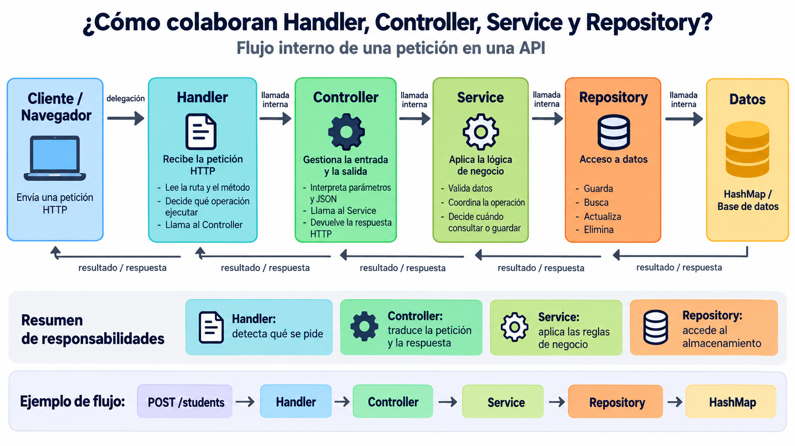

# Predictor del rendimiento de estudiantes

Student Performance Predictor es un ejemplo para aprender arquitectura de software en el aula. Un navegador utiliza una API HTTP en Java para gestionar estudiantes, la API almacena los estudiantes en memoria y coordina las peticiones, y un servicio independiente en Python calcula una nota prevista ficticia. Este diseño deliberadamente pequeño permite observar las responsabilidades de presentación, negocio, almacenamiento y servicios externos sin introducir infraestructura de producción.

## Arquitectura

```text
Navegador (HTML, CSS, JavaScript)
            |
            | HTTP en el puerto 8080
            v
API Java (HttpServer y HashMap)
            |                         |
            | POST /predict           | POST /reports/{format}
            | puerto 8000             | puerto 8001
            v                         v
API de predicción (FastAPI)   API de informes (FastAPI)
```

El servicio de informes es independiente del de predicciones y genera los documentos CSV y JSON. Java lo integra mediante el patrón Adapter, de modo que el controlador y el servicio solo dependen de la interfaz `ReportGenerator`.

El navegador se comunica únicamente con Java. Java también sirve el frontend, por lo que el ejemplo utiliza un único origen en el navegador y no necesita configuración CORS. Gson es la única dependencia de Java; Maven la descarga y proporciona comandos reproducibles para compilar y ejecutar el proyecto, pero Maven no forma parte de la lección.

## Requisitos previos

- JDK 21 o posterior
- Maven 3.9 o posterior
- Python 3.11 o posterior

## Ejecución en línea de comandos

Abre la carpeta del repositorio. Después, abre dos terminales.

En la primera terminal, inicia Python. Los siguientes comandos de PowerShell funcionan en Windows:

```powershell
cd python-api
python -m venv .venv
.venv\Scripts\Activate.ps1
python -m pip install -r requirements.txt
python -m uvicorn app.main:app --reload --port 8000
```

En macOS o Linux, activa el entorno con:

```bash
cd python-api
python3 -m venv .venv
source .venv/bin/activate
python -m pip install -r requirements.txt
python -m uvicorn app.main:app --reload --port 8000
```

En la segunda terminal, inicia el servicio de informes:

```powershell
cd report-api
python -m venv .venv
.venv\Scripts\Activate.ps1
python -m pip install -r requirements.txt
python -m uvicorn app.main:app --reload --port 8001
```

En macOS o Linux:

```bash
cd report-api
python3 -m venv .venv
source .venv/bin/activate
python -m pip install -r requirements.txt
python -m uvicorn app.main:app --reload --port 8001
```

En la tercera terminal, inicia Java:

```text
cd java-api
mvn compile exec:java
```

Abre estas direcciones:

- Aplicación web: <http://localhost:8080>
- Documentación interactiva de la API de predicción: <http://localhost:8000/docs>
- Documentación interactiva de la API de informes: <http://localhost:8001/docs>

Los datos de los estudiantes se almacenan únicamente en memoria y se eliminan cada vez que se detiene el proceso de Java.

## Ejecución con Docker Compose

Como alternativa a la ejecución manual, puedes construir e iniciar los servicios de Java y Python desde la raíz del repositorio:

```text
docker compose up --build
```

Abre la aplicación en <http://localhost:8080>. La documentación interactiva del servicio de predicción continúa disponible en <http://localhost:8000/docs> y la del servicio de informes en <http://localhost:8001/docs>. Dentro de Docker, Java utiliza los nombres de servicio `python-service` y `report-service` para comunicarse con los microservicios.

Para detener y eliminar los contenedores:

```text
docker compose down
```

Después de modificar el código o las dependencias, vuelve a construir las imágenes con:

```text
docker compose up --build
```

## Ejemplos de la API

PowerShell:

```powershell
Invoke-RestMethod -Method Post -Uri http://localhost:8080/students -ContentType "application/json" -Body '{"name":"Ana","studyHours":5}'
Invoke-RestMethod -Uri http://localhost:8080/students
Invoke-RestMethod -Uri http://localhost:8080/students/1/prediction
Invoke-RestMethod -Method Put -Uri http://localhost:8080/students/1 -ContentType "application/json" -Body '{"name":"Ana","studyHours":6}'
Invoke-RestMethod -Method Delete -Uri http://localhost:8080/students/1
```

Bash:

```bash
curl -X POST http://localhost:8080/students -H 'Content-Type: application/json' -d '{"name":"Ana","studyHours":5}'
curl http://localhost:8080/students
curl http://localhost:8080/students/1/prediction
curl -X PUT http://localhost:8080/students/1 -H 'Content-Type: application/json' -d '{"name":"Ana","studyHours":6}'
curl -X DELETE http://localhost:8080/students/1
```

Para llamar directamente a Python mientras se explica la separación entre servicios:

```powershell
Invoke-RestMethod -Method Post -Uri http://localhost:8000/predict -ContentType "application/json" -Body '{"study_hours":5,"difficulty":"MEDIUM"}'
```

El resultado es `7.5`. Se obtiene mediante la fórmula didáctica ficticia `min(10, study_hours * 1.5)` y no procede de un modelo entrenado ni constituye una predicción científicamente válida.

Para descargar un informe desde Java:

```bash
curl "http://localhost:8080/students/1/report?format=csv" -o report_1.csv
curl "http://localhost:8080/students/1/report?format=json" -o report_1.json
```

El informe incluye los datos del estudiante y sus matrículas con curso, año académico y nota. El contenido final lo genera siempre el microservicio Python de informes.

## Puntos de control didácticos

1. **REST básico:** comienza con `Student`, un `HttpServer` de Java, un `HashMap` y las operaciones de colección `GET /students` y `POST /students`. Utiliza los ejemplos de la API para explicar JSON, los métodos HTTP y los códigos de estado.
2. **Capas y CRUD:** separa `StudentController`, `StudentService` y `StudentRepository`; añade las operaciones de consulta, actualización y eliminación, junto con la interfaz HTML. El controlador contiene la lógica de presentación, el servicio mantiene las reglas de negocio y el repositorio es responsable del almacenamiento. Esto se parece a algunas ideas de MVC, pero una API HTTP no proporciona automáticamente una vista MVC tradicional.
3. **Servicios y predicción:** ejecuta FastAPI de forma independiente, llámala mediante `PredictionClient` y expone `GET /students/{id}/prediction`. Detén Python y repite una predicción para mostrar la respuesta `503` de Java. Dos programas que se comunican demuestran la descomposición en servicios, pero no todas las propiedades operativas de un sistema de microservicios de producción.




El repositorio mantiene una única versión final del código en lugar de tres carpetas duplicadas. Utiliza commits o etiquetas de Git para conservar estos puntos de control durante una secuencia didáctica en directo.

## Contrato REST

| Método | Ruta | Estado correcto | Propósito |
| --- | --- | --- | --- |
| GET | `/students` | `200` | Listar estudiantes |
| GET | `/students/{id}` | `200` | Consultar un estudiante |
| POST | `/students` | `201` | Crear un estudiante |
| PUT | `/students/{id}` | `200` | Actualizar un estudiante |
| DELETE | `/students/{id}` | `204` | Eliminar un estudiante |
| GET | `/students/{id}/prediction` | `200` | Solicitar una predicción ficticia |
| POST | `/predict` de Python | `200` | Calcular una predicción ficticia |
| GET | `/api/subjects` | `200` | Listar asignaturas |
| POST | `/api/subjects` | `201` | Crear una asignatura (`name`, `difficulty`: `EASY`, `MEDIUM` o `HARD`) |
| GET | `/students/{id}/subjects/{subjectId}/prediction` | `200` | Predicción según las horas de la matrícula y la dificultad |
| GET | `/students/{id}/report?format=csv\|json` | `200` | Descargar el informe académico del estudiante |
| POST | `/reports/{format}` de Python | `200` | Generar el contenido de un informe (`csv` o `json`) |
| GET | `/subjects` | `200` | Vista web de gestión de asignaturas |

Java devuelve `400` cuando la entrada no es válida, `404` para un estudiante o una ruta desconocidos, `405` para un método no permitido y `503` cuando el servicio de Python correspondiente no está disponible.

Las matrículas incluyen los campos opcionales `course`, `academicYear` y `grade` (entre 0 y 10). Estos datos alimentan los informes CSV y JSON generados por `report-api`.


